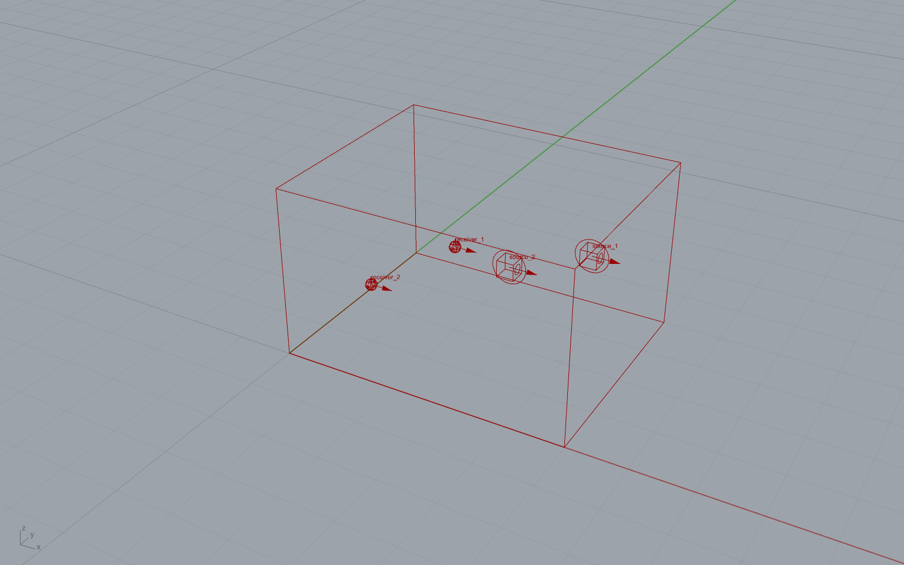

********************************************************************************
compas_acoustics
********************************************************************************

.. rst-class:: lead

compas_acoustics simulates, analyses and auralises the acoustics of rooms modelled with COMPAS or in Rhino and Grasshopper. It computes impulse responses with the image source method and ray tracing (Mono), and with a hybrid engine of image sources, edge diffraction and a directional feedback delay network (Binaural, Ambisonics); it derives room acoustic parameters (ISO 3382) from them and convolves them with anechoic recordings to listen to a design.

   The room of :doc:`grasshopper/examples/simple_simulation_shoebox`, with its sources and receivers, in Rhino.

Use it in Grasshopper or in Python
==================================

.. grid:: 1 1 2 2
   :gutter: 3

   .. grid-item-card:: Use in Grasshopper
      :link: grasshopper/getting_started
      :link-type: doc

      Components for Rhino 8 on Windows and macOS: build a room from Rhino geometry, simulate it, read its
      acoustic parameters and listen to it on the canvas. Start with the
      :doc:`installer <installation/grasshopper>`.

   .. grid-item-card:: Use in Python
      :link: python/tutorial
      :link-type: doc

      A COMPAS package: script scenes, simulation methods, analyses and auralisations, and run them in batches.
      Start with :doc:`installation/python`.

New to room acoustics? :doc:`concepts` explains the terms both tracks use.

Features
========

* **Simulation methods**: ``Mono`` (image sources and ray tracing, with pyroomacoustics), ``Binaural`` and
  ``Ambisonics`` (a hybrid of image sources, edge diffraction and a directional feedback delay network), all through
  ``scene.simulate``.
* **Analysis**: reverberation times, clarity and definition, direct-to-reverberant ratio, lateral fraction, strength
  and STI from an impulse response (``Analyser``).
* **Auralisation**: convolve mono, binaural or ambisonic responses with anechoic recordings (``Auraliser``), and play
  them (``AudioPlayer``).
* **Materials library**: 95 absorbing and scattering materials in categories, searchable from Python and Grasshopper.
* **Grasshopper plugin**: components for Rhino 8 on Windows and macOS that run every computation in a Python worker.

How to cite
===========

If you use ``compas_acoustics`` in your work, please cite it:

.. code-block:: bibtex

    @software{compas_acoustics,
      title  = {compas\_acoustics: room acoustic simulation, analysis and auralisation for COMPAS},
      author = {Xydis, Achilleas and Papadimitriou, Georgios and Cheng, Wang Hao and Edvaldsson, Gardar and Casas, Gonzalo},
      year   = {2025},
      organization = {Gramazio Kohler Research, ETH Zurich},
      url    = {https://github.com/gramaziokohler/compas_acoustics},
    }

.. toctree::
   :caption: Getting started
   :maxdepth: 2
   :titlesonly:

   Introduction <self>
   concepts
   installation/index

.. toctree::
   :caption: Python
   :maxdepth: 2
   :titlesonly:

   python/tutorial
   python/examples/index

.. toctree::
   :caption: Grasshopper
   :maxdepth: 2
   :titlesonly:

   grasshopper/getting_started
   grasshopper/components/index
   grasshopper/examples/index

.. toctree::
   :caption: Reference
   :maxdepth: 1
   :titlesonly:

   api
   troubleshooting
   contributing/docs
   changelog
   license

Indices and tables
==================

* :ref:`genindex`
* :ref:`modindex`
